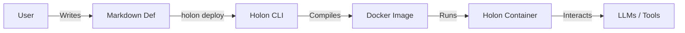

# Holon Design Specification

## 1. Architecture Overview

Holon is an agent orchestration engine designed to treat AI agents as microservices defined by simple text files. The architecture is centered around a **Compiler -> Runtime** model.

## 2. Core Concepts

### 2.1 The Holon Network
A **Holon Network** is a collection of collaborating agents and services. It is the unit of deployment.
- **Single Agent:** A network can consist of just one agent (e.g., a simple chatbot).
- **Multi-Agent:** A network can comprise multiple agents (e.g., Researcher, Writer, Reviewer) that communicate via addressed messages.

### 2.2 The Agent Definition (`.md`)
Each agent in the network is defined by a Markdown file.
- **Frontmatter (YAML):** Configuration, Identity (`id`), Model selection, Upstream triggers / Downstream targets.
- **Body (Markdown):** The System Prompt, Instructions, Knowledge Base.

### 2.3 The Runtime
The runtime is a lightweight Python application that executes inside the container. It is responsible for:
1.  **Parsing:** Reading the embedded markdown definition(s).
2.  **Orchestration:** Managing the message flow between agents in the network.
3.  **Lifecycle Management:** Initializing connections to LLMs and Tools.
4.  **Event Loop:** Listening for triggers (HTTP, Schedule, CLI) and executing the agent logic.
5.  **State Management:** Maintaining context and conversation history for each agent.

### 2.4 The Tool Protocol
Tools are pluggable capabilities. In the POC, we support:
- **Internal Tools:** Native Python functions mapped to the agent.
- **Model Tools:** Capabilities inherent to the model (Web Search in Perplexity/Grok).

## 3. Component Design

### 3.1 CLI (`holon`)
Built with `Typer` or `Click`.
- `init`: Scaffolds a new project.
- `test [path]`: Compiles markdown in default/specified path and runs interactive chat interface locally (no Docker).
- `deploy <file>`: Builds the standardized container image.

### 3.2 Parser
A robust wrapper around `python-frontmatter`. It enforces schema validation (Pydantic) on the YAML block to ensure the agent is valid before runtime.

### 3.3 Execution Engine
1.  **Loader:** Reacts to the parsed config.
2.  **Prompt Builder:** Combines system prompt (Markdown body) with dynamic context.
3.  **LLM client:** Powered by `litellm` to provide a unified interface to OpenAI, Anthropic, Groq, etc.
4.  **IO Handler:** Abstracts stdin/stdout (CLI mode) vs HTTP (Server mode).

## 4. Example Workflow

1.  User creates `analyst.md`.
2.  User runs `holon test analyst.md`.
3.  Runtime parses YAML: `{ model: "grok-beta", tools: ["search"] }`.
4.  Runtime extracts Body: "You are a senior data analyst..."
5.  Runtime enters REPL loop:
    - User types: "What is the stock price of NVDA?"
    - Runtime sends text + system prompt to Grok.
    - Grok uses internal "search" tool.
    - Grok returns answer.
    - Runtime displays to stdout.
